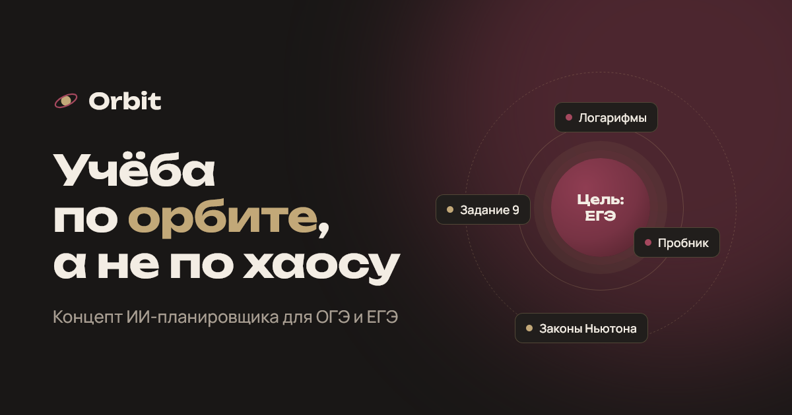

# Orbit — лендинг ИИ-планировщика учёбы

Концепт-проект: продукт вымышленный, дизайн и код настоящие.

**Сайт:** https://dima1playnsk-bot.github.io/orbit-landing/



## Что внутри

- Первый экран с «орбитой»: задачи дня вращаются вокруг цели.
- Макет приложения с отмечаемыми задачами и печатающейся подсказкой ИИ.
- Тарифы с переключателем «месяц / год», плавно раскрывающиеся вопросы, форма с проверкой почты.
- Адаптивная вёрстка, поддержка клавиатуры и настройки «уменьшить анимацию».

## Технологии

Чистые HTML, CSS и JavaScript — без фреймворков и сборки. Шрифты Unbounded и Manrope.

## Запуск

Открыть `index.html` в браузере или запустить локальный сервер:

```bash
python -m http.server 8000
```
